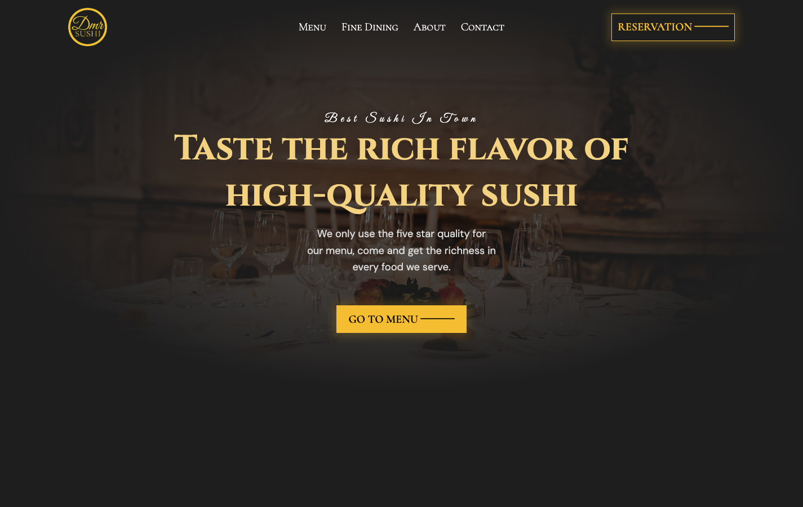
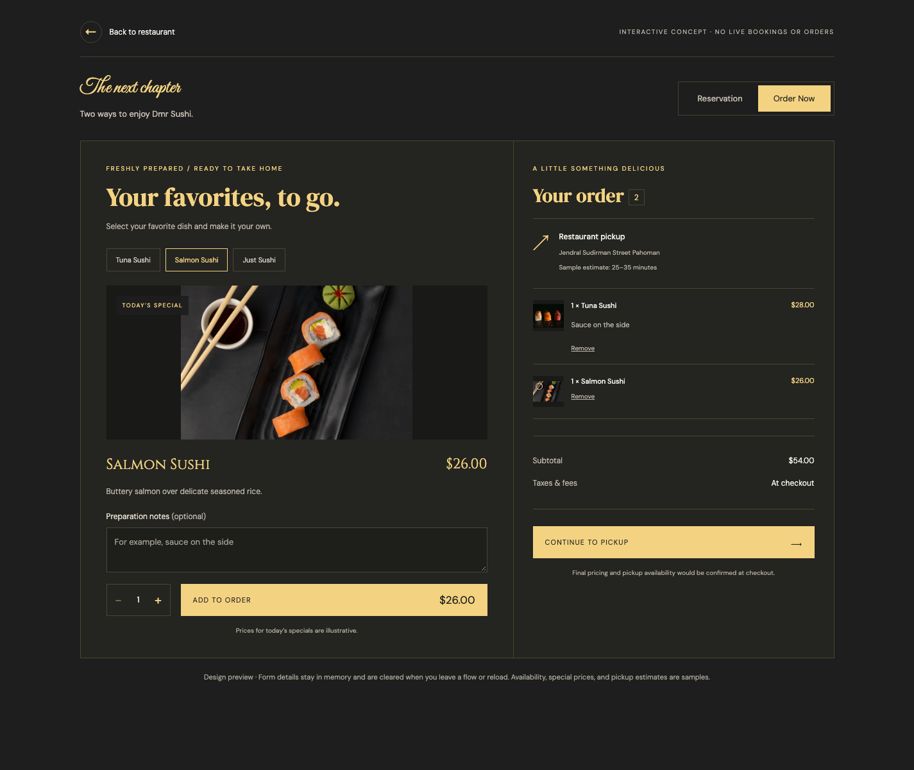

# Dmr Sushi — Restaurant Frontend

A responsive restaurant experience built with **React, React Router, and plain CSS**. Visitors can explore Japanese dishes, compare dining packages, preview a table reservation, and build a pickup order.

This portfolio project focuses on turning a visual restaurant concept into a working interface: reusable components, URL-based navigation, controlled forms, cart calculations, and layouts that adapt to small screens.

> **Demo scope:** Reservations and orders run entirely in the browser. Nothing is submitted to a restaurant, no payment is collected, and prices and availability are illustrative.



## A quick walkthrough

If you have a few minutes to review the project:

1. **Start at `/`** — resize the homepage to see how the navigation, typography, hero image, and call to action adapt.
2. **Explore `/menu`** — switch between seven categories. Each category has its own URL, so it can be opened directly or revisited with browser navigation.
3. **Select a special's “Order Now” link** — the selected dish opens in `/order`. Add different quantities and preparation notes, remove items, and check the subtotal. Continue to pickup to try validation and a sample confirmation.
4. **Try `/reservation`** — choose a visit date, party size, and time. Review the details, go back to edit them, and preview the confirmation.
5. **Visit `/fine-dining`** — switch between private and corporate packages. The contact page also links directly to the reservation flow.



## Features and implementation

| Area | What to look for |
| --- | --- |
| Responsive design | CSS Grid and Flexbox, fluid typography, breakpoint-based stacking, and layouts checked down to 320px. |
| Routing | Direct menu-category URLs, route state for the selected special, invalid-category recovery, and a usable 404 page. |
| Menu rendering | Seven categories and 21 dishes stored in a shared data module and rendered from the selected category. |
| Reservations | Controlled inputs, native date/email validation, keyboard-accessible time radios, review/edit steps, and form reset. |
| Pickup ordering | Independent cart lines, item quantities and notes, derived counts and subtotals, removal, phone validation, and confirmation/reset steps. |
| Accessibility | Page landmarks and headings, labeled fields, image alternatives, visible focus styles, and focus management between form steps. |
| Quality checks | ESLint, a production build, Playwright checks in desktop and mobile Chromium, and a GitHub Actions workflow. |

## Tech stack

- **React 19** for components, local state, refs, and effects.
- **React Router 7** for client-side routes, links, parameters, redirects, and navigation state.
- **Vite 8** for local development and production builds.
- **CSS** for the visual system and responsive layouts; no component library or CSS framework.
- **Playwright** for browser regression tests and **ESLint** for static checks.

## Run locally

Use **Node.js 24 or newer**, or Node.js **22.12+**, with npm.

```sh
git clone https://github.com/JustineVizco25/restaurant-landing-page-ui.git
cd restaurant-landing-page-ui
npm ci
npm run dev
```

Open the local URL Vite prints, usually `http://localhost:5173`. No environment variables or external API keys are required. Images are bundled locally. Google Fonts requires an internet connection; fallback fonts are configured.

| Command | Purpose |
| --- | --- |
| `npm run dev` | Start the development server. |
| `npm run lint` | Run ESLint. |
| `npm run build` | Create the production bundle in `dist/`. |
| `npm run preview` | Serve the production bundle locally. |
| `npm test` | Run the browser regression tests. |
| `npm run test:ui` | Open Playwright's interactive test runner. |

### Browser tests

Install Playwright's Chromium browser once, then run the suite:

```sh
npx playwright install chromium
npm test
```

Playwright starts the development server automatically, or reuses it locally if it is already running. Eight scenarios run against both desktop and mobile configurations, giving **16 checks** covering navigation, category routes, cart calculations, pickup validation, reservation editing, reset behavior, event tabs, and page structure.

To use an existing Chrome installation instead of downloading Chromium, set `PLAYWRIGHT_CHROME_PATH` to its executable path. Failure screenshots and traces are saved to `test-results/` and excluded from Git.

GitHub Actions runs dependency installation, linting, the production build, and the same browser suite on pushes to `main` and pull requests.

## Code tour

```text
src/
├── App.jsx                  # Routes, page layout, redirects, and 404 handling
├── App.css                  # Restaurant styling and responsive layouts
├── fonts.css                # Font imports
├── main.jsx                 # React entry point and BrowserRouter
├── components/
│   ├── navbar.jsx           # Navigation and measured header height
│   ├── hero.jsx             # Homepage
│   ├── menu.jsx             # Category navigation and dish rendering
│   ├── finedining.jsx       # Private/corporate event packages
│   ├── about.jsx            # Restaurant story
│   ├── contacts.jsx         # Location and reservation entry point
│   ├── reservation.jsx      # Flow switcher and reservation steps
│   ├── order.jsx            # Dish selection, cart, and pickup steps
│   └── booking.css          # Shared reservation and order styles
├── data/menu.js             # Category, ingredient, image, and price data
└── assets/                  # Photography, branding, and decorative assets
tests/restaurant.spec.js     # Browser regression scenarios
playwright.config.js        # Desktop/mobile projects and local test server
.github/workflows/ci.yml     # Automated frontend checks
```

Useful starting points for a code review:

- [`menu.jsx`](src/components/menu.jsx) and [`data/menu.js`](src/data/menu.js): data-driven rendering and route-driven category selection.
- [`order.jsx`](src/components/order.jsx): cart updates, derived totals, and pickup validation.
- [`reservation.jsx`](src/components/reservation.jsx): form state, review/edit transitions, and keyboard focus.
- [`restaurant.spec.js`](tests/restaurant.spec.js): user journeys and regression coverage.

## Decisions and boundaries

**Local state fits the demo.** Form steps use named states such as `details`, `review`, and `done`. Cart totals are calculated from cart items rather than stored separately. There is no global state library because these interactions stay within their respective flows.

**Different preparation notes remain separate.** Adding the same dish twice creates separate cart lines, so a request such as “no wasabi” is not merged into another guest's order.

**URLs represent browsing state.** A category is part of the menu URL; a featured dish is passed through router navigation state when entering the order flow. Unknown categories redirect to the main menu.

**This is a frontend portfolio exercise.** The presentation follows supplied restaurant references and uses demo branding and imagery. Social links point to the platforms' homepages. Only the three featured specials can be ordered. Data clears when leaving a flow or reloading; there is no backend, payment integration, or real availability check.

Potential next steps include API-backed booking and ordering, optimized responsive image formats, and broader cross-browser accessibility testing.

## Deployment notes

`npm run build` creates a static site in `dist/`. Since the app uses `BrowserRouter`, configure the host to serve `index.html` for application routes such as `/menu/wine` and `/reservation`; otherwise refreshing a nested URL can return a server 404. Vite's preview server supports these routes locally.

The repository contains the source and lockfile. Dependencies, builds, reference downloads, local backups, environment files, and browser-test output are excluded through [`.gitignore`](.gitignore).

---

Portfolio project maintained by [JustineVizco25](https://github.com/JustineVizco25).
